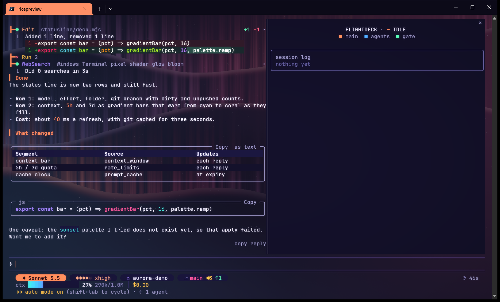
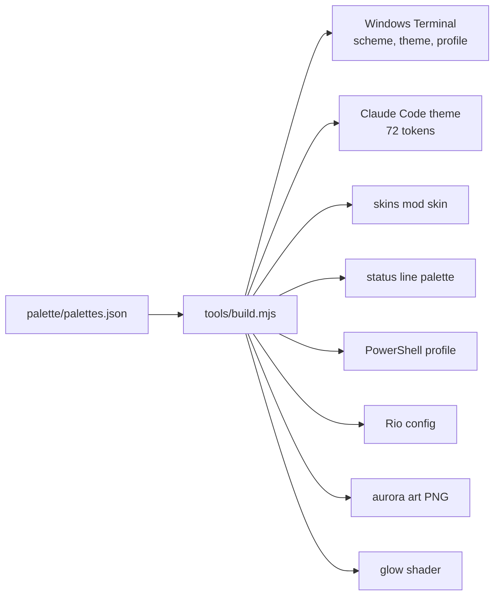
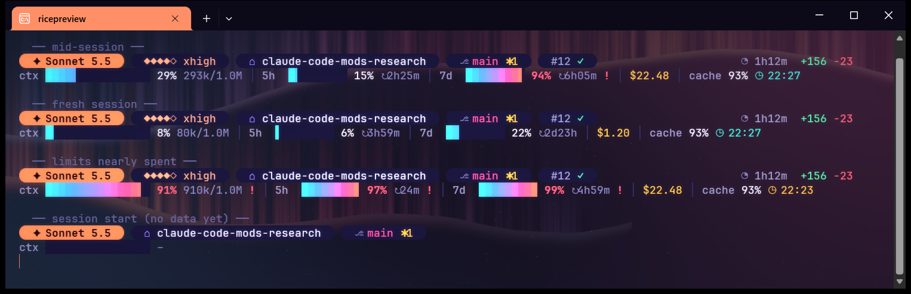
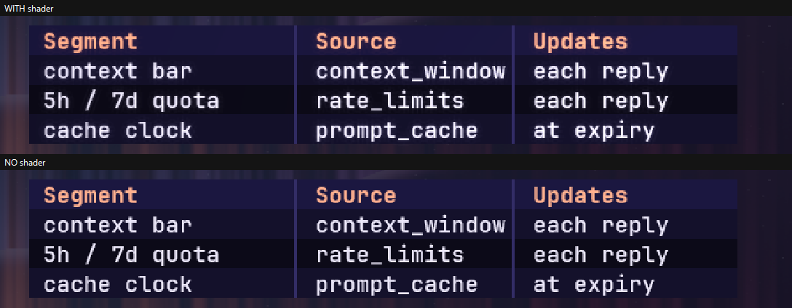

# v2-win: Claude Aurora

A from-scratch visual rice for Claude Code on Windows 11 and Windows Terminal. **One palette** drives everything: the terminal (colours, an aurora background, a glow shader, the tab row), the Claude Code theme, the transcript skin, a two-row status line, the flightdeck panel, PowerShell and Rio. It replaces the minimal v1.1 setup. Nothing third-party was added: the status line, shader, art, theme and tooling are all in this folder, and the one change to a mod you already ran is a small patch.



*The real Claude Code 2.1.300 resuming a synthetic demo session (no prompt sent, no usage spent), with only the applied config.*

## What changed from v1.1

| | v1.1 | v2 |
|---|---|---|
| Look | warm brown, flat | midnight indigo, Claude coral, a cyan→pink aurora |
| Terminal | acrylic, plain background | aurora art behind the text, a bloom shader, indigo tab row, coral window frame |
| Status line | claude-hud: folder + git + cache clock | **Aurora Deck**: two rows, pills and gradient gauges for model, effort, folder, git, PR, context, 5h, 7d, cost, cache |
| Transcript | `claude-warm` skin, rail off | `claude-aurora` skin, **rail on, one row per tool call** (local patch) |
| Right pane | flightdeck with the vitals panel | flightdeck without it (the deck owns the vitals), on a palette-coloured fill |
| Prompt | brown path and `»` | violet path, pink `⎇ branch`, a coral `❯` that goes red after a failed command |

## Use it

```powershell
cd v2-win
npm test                              # 37 tests, no dependencies
node tools/rice.mjs apply --dry-run   # what it would touch
node tools/rice.mjs apply             # back up every file, then install
node tools/rice.mjs status
node tools/rice.mjs revert            # restore the newest backup, byte for byte
```

`apply` copies each file it touches to `~/.rice/backups/<timestamp>/` first, then **merges** into it: keys the rice does not own are left alone (the tests check this against a sandbox copy of your layout). The Windows Terminal and Claude Code changes show up live; **restart Claude Code once** to load the skin and the patched rail. `--no-terminal` leaves Windows Terminal, the PowerShell profile and Rio alone.

To make a *new* terminal pick up the right `claude` after a PATH change, close **every** Windows Terminal window and reopen it; a tab opened inside a running Windows Terminal keeps its old environment (this is the cause of the "Update available! Run: winget upgrade" banner, see v1.1).

## One palette, many files



Add a palette to `palette/palettes.json`, run `node tools/rice.mjs audit <name>` (it refuses unreadable colours: text contrast of 10:1, muted 5.5:1, every accent and tool colour 5:1, the dim and faint tones 3:1 and 4.5:1), then `build` and `apply <name>`. The reference output for the default palette is in `generated/aurora/`.

## The status line: Aurora Deck



`statusline/aurora-deck.mjs` is one file with no dependencies. It reads Claude Code's documented status-line JSON and draws:

- **Row 1, identity pills:** model (with ⚡ when fast mode is on), a five-pip effort meter, folder, git branch with `✱` changed files, `↑` unpushed and `↓` behind, the open PR with its review state, the agent name and vim mode when present, and on the right the session clock and lines added and removed.
- **Row 2, gauges:** context, 5h and 7d as gradient bars with 1/8-cell precision. The colour follows the cell's place on the ramp, so a nearly empty bar is cool and a nearly full one is warm. The percentage goes amber then red with a `!` as a quota runs out, with the reset countdown beside it, then cost and the prompt-cache clock (`◷ 22:27`, amber in the last minute, `cold` after it expires).
- **Width:** it sizes itself from `COLUMNS`. Windows of about 112 columns and up get everything. Below that the bars shrink and the extras go in tiers: token counts, lines changed, the agent and vim pills first, then reset times, cost and the PR and effort pills, then the session and cache clocks. Anything that still does not fit is cut from the right, and the identity row finally shortens the folder name with an ellipsis. A test checks that no row is wider than the terminal at any width from 44 to 220 columns.
- **Never blank:** Claude Code blanks the row on a non-zero exit, so any error prints a one-word fallback and exits 0. Missing or null data renders an empty state.
- **Fast:** about 40 ms of Node, about 170 ms end to end through Git Bash (`exec` of a `.cmd` shim, which also avoids stranded `node.exe` processes). `git status` is cached for 3 seconds with a 1.5 s timeout, falling back to reading `.git/HEAD`.
- **Safe:** user-controlled text (folder, branch, model, agent) has control characters stripped, so a hostile name cannot inject escape sequences. It imports only Node built-ins (a test enforces that). `NO_COLOR` is deliberately ignored: Claude Code's own tool shells set it, and this output is only ever drawn by Claude Code.

`RICE_CAPS=block` swaps the rounded pill caps for block characters if a font ever renders the powerline glyphs as boxes. `RICE_DEMO_GIT` forces the git pill for screenshots of a folder that is not a repository.

## The terminal



- **Aurora art:** `art/aurora-art.mjs` renders a 2560×1440 PNG from the palette with no dependencies. Light is accumulated in linear space and tone-mapped, so overlapping ribbons glow instead of turning grey; the colour ramp ping-pongs, so there are no seams; the middle is kept calm so text stays readable. It sits at 42% opacity behind the text and is seeded, so it is reproducible. Preview: `docs/screenshots/aurora-art.png`.
- **Glow shader:** `shaders/glow.hlsl` blooms bright text in its own colour (coral glows coral), with a faint vignette. It does not read `Time`, so it never needs to animate. The three constants at the top are the knobs. `tools/check-shader.ps1` compiles it with the system's own HLSL compiler (the one Windows Terminal uses), so a typo cannot silently disable it.
- **Chrome:** the tab row follows the terminal colour and the window frame is coral. Mica, a transparent tab row, and the art behind the tabs were all tried; Windows Terminal drew the tab row opaque every time, so they are not used.
- **PowerShell:** the profile keeps your options and key bindings, recolours the syntax highlighting and the icon `ls`, and adds the prompt below. The branch comes from reading `.git/HEAD`, so the prompt never starts `git`.


## Claude Code itself

- **Theme (`claude/theme.json`, 72 tokens):** includes tokens the documentation leaves out. `composerSidebarBackground` is the fill of side panes (a neutral grey in the stock dark theme, which is why flightdeck looked like an unthemed rectangle); `clawd_body` and `clawd_background` colour the mascot; `claudeBlue_FOR_SYSTEM_SPINNER`, `skill`, `professionalBlue` and `chromeYellow` are the rest. A test checks every token name against the table inside Claude Code, because an unknown token is silently ignored.
- **Skin `claude-aurora`:** all 15 palette slots, rail on, usage band off (so usage is shown once).
- **Rail on one row:** `patches/skins-rail-on-the-node-row.patch` makes a tool call `┣━● Run 1` instead of a connector row plus a node row. Consecutive `┣` stack into one unbroken vertical line. It is a commit in your local marketplace (`c61bd3d`), so its tamper check stays clean.
- **flightdeck:** its `panels` option drops `main`, because the deck owns model, effort, context and quota. Nothing is shown twice.
- **claude-hud** is switched off (its files are untouched). **No new third-party code** was installed in v2.

## What I verified, and how

- **37 tests**: the status line (16: widths from 44 to 220 columns, null data, thresholds, the cache clock, hostile text, git parsing and caching, a drift guard against the palette file), the palette and theme (10), and apply and revert (11, against a throwaway copy of your layout: merges keep unrelated keys, applying twice changes nothing, revert is byte-identical).
- **The real UI**: Claude Code 2.1.300 resuming a synthetic transcript (`tools/make-demo-session.mjs`) and photographed with a harness that captures only its own window (`tools/preview/`). That is where the powerline caps, the single-row rail, the pane colour and the flightdeck split were all confirmed.
- **The status line as Claude Code runs it:** through Git Bash with the payload on stdin; exit 0, 168 ms, no stray processes.

## What I did not verify

- How it looks in **your live session**: I never captured your open window. The applied config was checked in a fresh tab and in a fresh Claude Code process.
- **Real usage numbers** in the deck: the demo has no API response, so the 5h and 7d rows were checked with the documented payload shape, not a live one.
- **Rio**: its config is regenerated but Rio's elevated ConPTY step has still not been run.
- **Battery and heat**: the shader is static, but the cost of the background image on battery was not measured.

## Layout

```
palette/            palettes.json (the one source of colour)
tools/              rice.mjs (CLI), build.mjs, apply.mjs, lib/, make-demo-session.mjs, preview-claude.mjs, probe-scheme.mjs,
                    preview-theme.mjs, check-shader.ps1, preview/ (screenshot harness and scenes)
statusline/         aurora-deck.mjs
art/                aurora-art.mjs
shaders/            glow.hlsl
patches/            skins-rail-on-the-node-row.patch
generated/aurora/   what the build produces (except the 4 MB art)
tests/              statusline, build, apply
docs/               FINDINGS.md, screenshots/
```

See [`docs/FINDINGS.md`](docs/FINDINGS.md) for the non-obvious things this turned up.

## Next, if you want it

- An **animated** aurora: a second shader that drifts the background. It makes Windows Terminal redraw continuously, so measure the CPU first on a laptop that already runs hot.
- Two or three **community visual mods**, each vetted first (read the source, `claude plugin validate`, pin the commit). The ones worth a look are in `../research_notes/`.
- More palettes: the build and the audit are already general.
