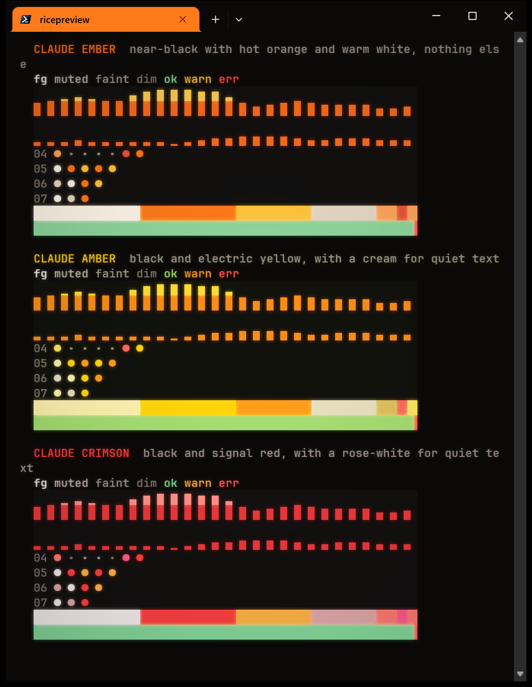
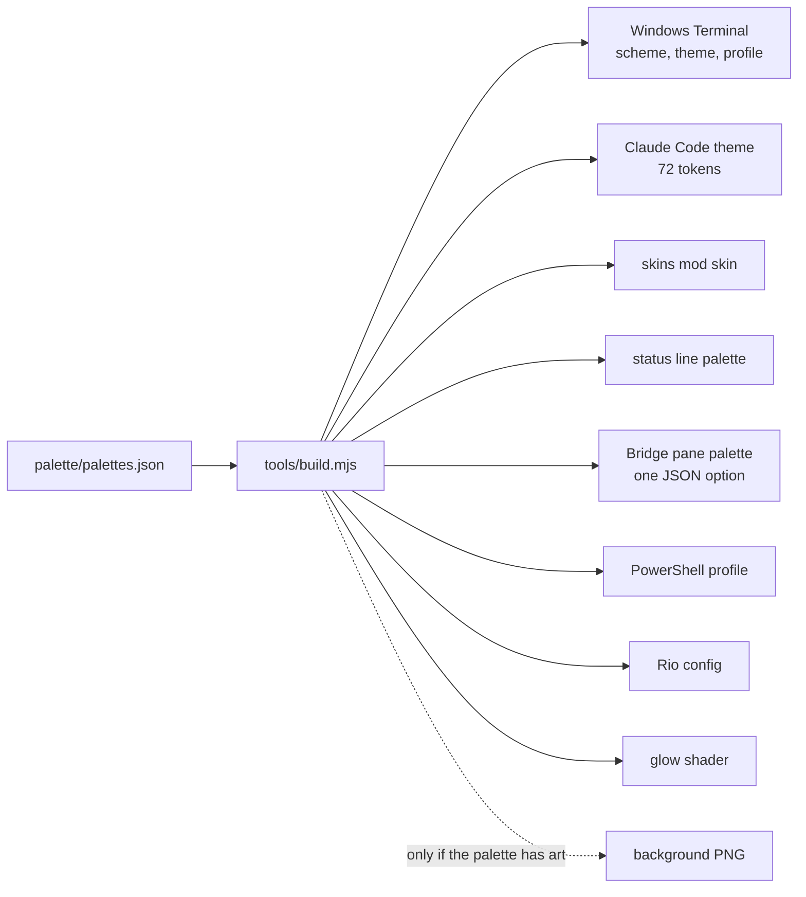
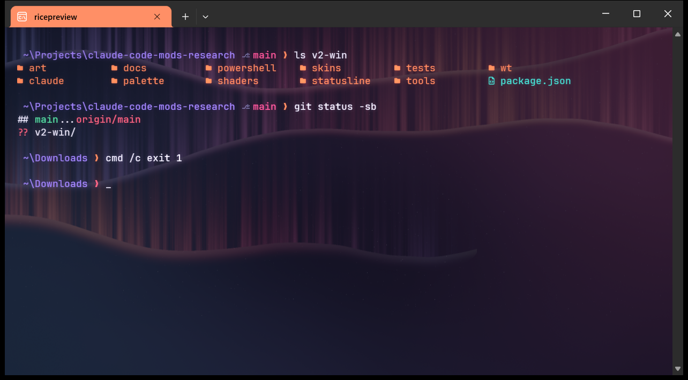

# v2-win: Claude Ember

A from-scratch visual rice for Claude Code on Windows 11 and Windows Terminal. **One palette** drives everything: the terminal (flat near-black, an orange tab and frame, a soft glow on bright text), the Claude Code theme, the transcript skin, a two-row status line, a first-party **Bridge** pane on the right, PowerShell and Rio. It replaces the minimal v1.1 setup.

The default look is **black, hot orange and warm white**, with no background picture, and every kind of detail has its own warm shade so the text is not one flat white: orange headings and numbers, gold bold labels, peach paths, flame version numbers, salmon inline code, apricot links. Two sibling palettes are one command away (`amber`: black and electric yellow, `crimson`: black and signal red), and the original indigo-and-aurora look is still there as `aurora`.


*The real Claude Code 2.1.301 resuming a synthetic demo session (no prompt sent, no usage spent), with the applied config and the Bridge pane's demo data switched on.*

## Pick a palette



*All three photographed in the real Claude Code UI (the Bridge pane too, which is outside these crops).*

```powershell
node tools/rice.mjs apply ember     # orange, white, black (default)
node tools/rice.mjs apply amber     # yellow, black, with cream for quiet text
node tools/rice.mjs apply crimson   # red, black, with rose-white for quiet text
node tools/rice.mjs apply aurora    # the original indigo / cyan / pink, with the background art
```

Each `apply` backs up what it touches first, and switching from a palette with a background picture to one without removes the picture again. The Claude Code theme hot-reloads, Windows Terminal changes live, and the Bridge pane and status line pick the new colours up on the next Claude Code start (the status line on its next refresh).

## What changed from v1.1

| | v1.1 | v2 |
|---|---|---|
| Look | warm brown, flat | near-black with one hot accent (orange by default) |
| Terminal | acrylic, plain background | flat colour, a glow on bright text, orange tab row and window frame |
| Status line | claude-hud: folder + git + cache clock | **Aurora Deck** (the name is historical): two rows, pills and gradient gauges for model, effort, folder, git, PR, context, 5h, 7d, cost, cache |
| Transcript | `claude-warm` skin, rail off | skin in the palette, **rail on, one row per tool call** (local patch) |
| Right pane | flightdeck | **Bridge**, our own: heartbeat, per-call timeline, gate, agents, hot files, last turn |
| Prompt | brown path and `»` | pale path, red `⌥ branch`, an orange `❯` that goes red after a failed command |

## Use it

```powershell
cd v2-win
npm test                              # 50 tests, no dependencies
node tools/rice.mjs apply --dry-run   # what it would touch
node tools/rice.mjs apply             # back up every file, then install the default palette
node tools/rice.mjs status
node tools/rice.mjs revert            # restore the newest backup, byte for byte
```

`apply` copies each file it touches to `~/.rice/backups/<timestamp>/` first, then **merges** into it: keys the rice does not own are left alone (the tests check this against a sandbox copy of your layout). **Restart Claude Code once** to load the skin, the patched rail and the Bridge. `--no-terminal` leaves Windows Terminal, the PowerShell profile and Rio alone.

To make a *new* terminal pick up the right `claude` after a PATH change, close **every** Windows Terminal window and reopen it; a tab opened inside a running Windows Terminal keeps its old environment (this is the cause of the "Update available! Run: winget upgrade" banner, see v1.1).

## One palette, many files



Add a palette to `palette/palettes.json`, run `node tools/rice.mjs audit <name>` (it refuses unreadable colours: text contrast of 10:1, muted 5.5:1, every accent and tool colour 5:1, the dim and faint tones 3:1 and 4.5:1), then `apply <name>`. A palette with `"art": null` gets no background picture. Reference output for every palette is in `generated/<name>/`.

## The Bridge pane

`mods/aurora-bridge/` is a Claude Code mod written for this rice (a snapshot; the pinned copy that Claude Code actually loads is in the local marketplace, `claude-mods-local`). It docks on the right and shows what Claude is doing, as it does it:

- **Heartbeat:** a flame equaliser (eighth-block glyphs, hot at the foot and bright at the tip). It runs fast while Claude works (8 frames a second) and slowly when idle (2 a second, and the state is not even read on the ticks in between), repainted in place by `$.ui.blit` without redrawing the pane.
- **Activity:** one dot per tool call, a row per turn, a colour per kind of tool (read, write, run, search, web, MCP, agent). A running call pulses, a failed one is a red `✕`, a subagent's call is a smaller dot. Under it a legend with counts and a stacked bar of the mix.
- **Gate:** how many permission checks were allowed, asked and denied.
- **Agents:** subagents, running first, with the elapsed time.
- **Hot files:** the most-edited files.
- **Last turn:** tools, errors, duration, output tokens.

It only watches. Every hook hands its event on untouched (a test checks that a deny, an error result and a gate verdict come back exactly as the engine gave them), and if the pane's own bookkeeping ever throws, the call carries on. Options (`/plugin configure aurora-bridge`): `palette` (a JSON object; `apply` writes it from the palette file, empty uses built-in Ember), `width` (columns it asks for, 40-100), `animate` (`on`/`off`), `openOnStart`, `demo` (`on` fills it with a made-up session, for screenshots). `/bridge` opens it at any width; unasked it seats from 144 columns. On a surface without `Raster` (desktop, VS Code) it draws as plain text.

Install and check it:

```powershell
claude plugin install aurora-bridge@kasasree-mods --scope user
cd mods/aurora-bridge
npm test                    # 31 unit tests: reducers, rasters, palette parsing
claude plugin test .        # 8 tests against the engine's own harness
claude plugin validate .
```

## The status line: Aurora Deck


`statusline/aurora-deck.mjs` is one file with no dependencies. It reads Claude Code's documented status-line JSON and draws:

- **Row 1, identity pills:** model (with ⚡ when fast mode is on), a five-pip effort meter, folder, git branch with `●` changed files, `↑` unpushed and `↓` behind, the open PR with its review state, the agent name and vim mode when present, and on the right the session clock and lines added and removed.
- **A spacer row** between the two. Claude Code drops a status-line row that is empty or holds only an escape code (measured: both gave no gap), so the spacer carries a zero-width space.
- **Row 2, gauges:** context, 5h and 7d as gradient bars with 1/8-cell precision. The colour follows the cell's place on the palette's ramp, so a nearly empty bar is pale and a nearly full one is hot. The percentage goes amber then red with a `!` as a quota runs out, with the reset countdown beside it (`◔ 2h26m`), then cost and the prompt-cache clock (`◕ 22:27`, amber in the last minute, `cold` after it expires).
- **Only glyphs the font has.** A glyph missing from JetBrainsMono NFM is drawn from a fallback font at another width and spills into the next cell; that is how the old reset arrow `↻` ended up touching its time. Every glyph the line draws is now in the font (read from the font's own glyph table), and a test fails if a new one is added that is not.
- **Width:** it sizes itself from `COLUMNS`. Windows of 123 columns and up get everything (measured with a full payload; from 116 to 122 the cache clock is the first thing cut from the right). Below that the bars shrink and the extras go in tiers: token counts, lines changed, the agent and vim pills first, then reset times, cost and the PR and effort pills, then the session and cache clocks. Anything that still does not fit is cut from the right, and the identity row finally shortens the folder name with an ellipsis. A test checks that no row is wider than the terminal at any width from 44 to 220 columns.
- **Never blank:** Claude Code blanks the row on a non-zero exit, so any error prints a one-word fallback and exits 0. Missing or null data renders an empty state.
- **Fast:** about 40 ms of Node, about 170 ms end to end through Git Bash (`exec` of a `.cmd` shim, which also avoids stranded `node.exe` processes). `git status` is cached for 3 seconds with a 1.5 s timeout, falling back to reading `.git/HEAD`.
- **Safe:** user-controlled text (folder, branch, model, agent) has control characters stripped, so a hostile name cannot inject escape sequences. It imports only Node built-ins (a test enforces that). `NO_COLOR` is deliberately ignored: Claude Code's own tool shells set it, and this output is only ever drawn by Claude Code.

`AURORA_DECK_ROWS=1` (added for v5, whose bands above the prompt show context, 5h, 7d and cost) draws only the identity row and moves the prompt-cache clock onto it. `RICE_CAPS=block` swaps the rounded pill caps for block characters if a font ever renders the powerline glyphs as boxes. `RICE_DEMO_GIT` forces the git pill for screenshots of a folder that is not a repository.

## The terminal

- **Flat colour, no picture.** The plain palettes carry `"art": null`, so Windows Terminal gets just the scheme background. The aurora PNG generator (`art/aurora-art.mjs`) is still there for the `aurora` palette.
- **Glow shader (off since 2026-10-17):** the halo made the text look soft, which was not liked, so it is now opt-in: only a palette with `"glow": true` gets it (just `aurora`), and applying a palette without it removes the shader from Windows Terminal. `shaders/glow.hlsl` adds a soft halo round bright text, in the text's own colour (orange text glows orange), plus a faint vignette. It is a difference of blurs: glow is added only where the neighbourhood is brighter than the pixel itself, so a large flat bright area (a pane fill, a gradient bar) is left exactly as drawn. The first version lifted every bright area and washed the Bridge's colours out; that is why it was rewritten. It does not read `Time`, so it never needs to animate. The constants at the top are the knobs; set `GLOW_STRENGTH` to 0 to turn the halo off. `tools/check-shader.ps1` compiles it with the system's own HLSL compiler (the one Windows Terminal uses), so a typo cannot silently disable it.
- **Chrome:** the tab row follows the terminal colour and the window frame takes the palette's accent. Mica, a transparent tab row, and the art behind the tabs were all tried; Windows Terminal drew the tab row opaque every time, so they are not used.
- **PowerShell:** the profile keeps your options and key bindings, recolours the syntax highlighting and the icon `ls`, and adds the prompt below. The branch comes from reading `.git/HEAD`, so the prompt never starts `git`.



## Claude Code itself

- **Theme (`claude/theme.json`, 72 tokens):** includes tokens the documentation leaves out. `composerSidebarBackground` is the fill of side panes (a neutral grey in the stock dark theme); `clawd_body` and `clawd_background` colour the mascot; `claudeBlue_FOR_SYSTEM_SPINNER`, `skill`, `professionalBlue` and `chromeYellow` are the rest. A test checks every token name against the table inside Claude Code, because an unknown token is silently ignored.
- **Skin `claude-<palette>`:** all 15 palette slots, rail on, usage band off (so usage is shown once).
- **Detail colour comes from the tool colours.** The skin draws a reply's highlights from its seven tool slots: `read` is paths, types and properties; `write` is edits and variables; `run` is shell rows, strings and (patched) **bold text**; `search` is inline code and the numbers and literals in code (numbers in prose take the accent); `web` is links and keywords; `mcp` is version numbers and function names. If those slots are near-white the whole reply is white, which is exactly what the first Ember did. Each plain palette now gives every slot its own warm shade (`palette/palettes.json`), and tests fail if a slot is too close to white, if two slots look alike (OKLab distance under 0.05), or if a blue, purple or cyan sneaks back in. A palette can also pin single theme tokens with a `"theme"` block (the prompt frame is a dim accent instead of a pale tint).
- **Three small skin patches** on top of the rail one (`patches/skins-bold-bullets-table-headers.patch`): bold takes the `run` colour, bullet marks take the accent, table header rows take the accent. One commit in the local marketplace (`5486b65`), so its tamper check stays clean.
- **Rail on one row:** `patches/skins-rail-on-the-node-row.patch` makes a tool call `┣━● Run 1` instead of a connector row plus a node row. It is a commit in your local marketplace (`c61bd3d`), so its tamper check stays clean.
- **Right pane:** the Bridge. `apply` enables it and switches flightdeck off (still installed; `revert` or a one-line settings change brings it back). If the Bridge is not installed, `apply` keeps flightdeck and recolours it through the theme, as in the first v2.
- **claude-hud** is switched off (its files are untouched).

## What I verified, and how

- **50 rice tests** (status line 19, palette and theme 18, apply and revert 13, against a throwaway copy of your layout: merges keep unrelated keys, applying twice changes nothing, revert is byte-identical, switching to a palette with no art removes the old picture) and **39 Bridge tests** (31 unit tests, 8 against the engine's own `claude plugin test` harness), plus `claude plugin validate`. The patched skins mod's own suite passes too (220 of 220; four upstream tests were rewritten to check the patched rail and the removed update check, see the local marketplace README).
- **The real UI, in all three palettes:** Claude Code 2.1.301 resuming a synthetic transcript and photographed with a harness that captures only its own window (`tools/preview/`). The Bridge, the theme, the status line, the rail and the detail colours were confirmed there for ember, amber and crimson (`docs/screenshots/palettes.png`). The status line spacer was tried three ways in that UI (empty line, escape-only line, zero-width space); only the last produced a gap.
- **That the heartbeat really animates:** four captures of the same window 500 ms apart. Working (demo data), the heartbeat region changed by 1,000 to 1,300 sampled pixels between frames; idle, by 100 to 140 (a slow drift); the transcript, used as a control, by 0. (`shot.ps1 -Burst 4 -BurstMs 500` does it.)
- **The mod loads cleanly in a real session:** the debug log lists its eight events, shows the pane placed, and has no refused or skipped hook.

## What I did not verify

- **A live model turn with the Bridge running.** Its counting was verified by raising the real events through the engine's harness (tool calls, gate checks, agent spawns, turn ends) and its look by the demo state, but I did not watch it through an actual conversation. Two things to watch for: a subagent's end is detected from its own `turn.complete`, and a **resumed session does not replay history into the pane** (hooks only see live events), so it starts empty and fills as you work.
- **Diff colours.** The code inside an Edit row's diff is coloured by Claude Code's own highlighter (pink, cyan, green and purple, the same under every palette). The theme has no syntax tokens, so that is the one place a cool hue still shows. The only control is the `syntaxHighlightingDisabled` setting, which would make diff code plain white; I left it on. Replacing that renderer with the skin's own palette-coloured one is possible but was not attempted.
- How it looks in **your live session**: I never captured your open window.
- **Real usage numbers** only partly: the status line text you pasted from your own session on 2026-10-17 showed real context, 5h, 7d, cost and cache values rendering, but no screenshot of a live session was taken. **Rio** (its elevated ConPTY step has not been run), and the **battery cost** of the shader and the heartbeat (idle is 2 fps, but I did not measure CPU).

## Layout

```
palette/            palettes.json (the one source of colour): ember, amber, crimson, aurora
tools/              rice.mjs (CLI), build.mjs, apply.mjs, lib/, make-demo-session.mjs, preview-claude.mjs, probe-scheme.mjs,
                    preview-theme.mjs, check-shader.ps1, preview/ (screenshot harness and scenes)
mods/aurora-bridge/ the Bridge pane (hooks/, types/, tests/); the loaded copy lives in the local marketplace
statusline/         aurora-deck.mjs
art/                aurora-art.mjs (only the aurora palette uses it)
shaders/            glow.hlsl
patches/            skins-rail-on-the-node-row.patch, skins-bold-bullets-table-headers.patch
generated/<name>/   what the build produces for each palette (except the 4 MB aurora art)
tests/              statusline, build, apply
docs/               FINDINGS.md, screenshots/
```

See [`docs/FINDINGS.md`](docs/FINDINGS.md) for the non-obvious things this turned up.

## Next, if you want it

- Keep whichever of **ember**, **amber** and **crimson** you like; delete the others from `palettes.json` if you want it tidy.
- Draw **diffs with the skin's own colours** (the last cool hues left), by routing the Edit row's diff through the skin's palette-coloured renderer.
- A Bridge **panel picker** (an option to hide Hot files or Agents) and a small `claude --resume` replay that rebuilds the timeline from the transcript.
- Two or three **community visual mods**, each vetted first (read the source, `claude plugin validate`, pin the commit).
