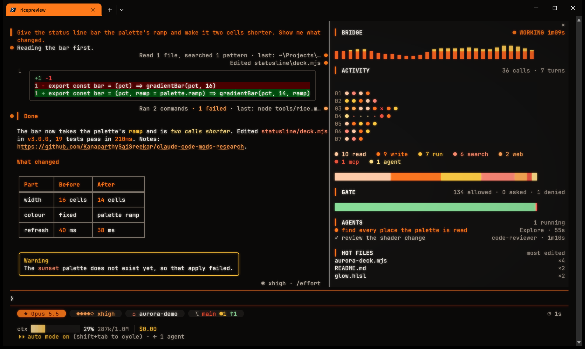
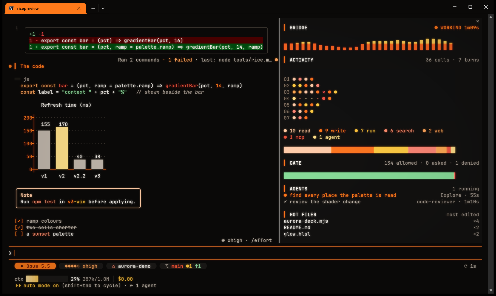
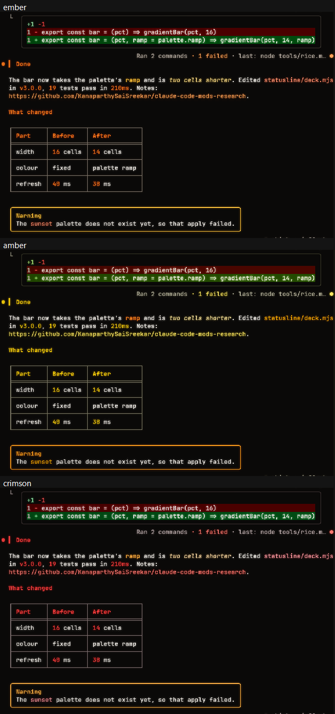

# v3-win: Prismantis Ember

v3 takes a **popular community mod** and makes it part of the rice instead of building one from scratch. The mod is [prismantis](https://github.com/NahumLitvin/prismantis) by Nahum Litvin (118 stars on 2026-10-17, 44 release tags, the most active reply renderer in the [awesome-claude-code-mods](https://github.com/karanb192/awesome-claude-code-mods) scan, and one of its six Featured picks). It redraws Claude's replies: tables, code cards with Prism highlighting, mermaid charts and flowcharts, GitHub alerts, task lists, diff cards and compact tool rows.

v3 runs it **in the rice's own palettes** (ember, amber, crimson), with a `▍` heading bar like the skins headings you liked, and with its per-prompt hint turned off. Everything else from v2 stays: the theme, the status line, the Bridge pane, Windows Terminal and PowerShell.



*The real Claude Code 2.1.301 resuming a synthetic session (no prompt sent, no usage spent), with v3 applied for that one process only.*

## v3 on its own (Gruvbox, all matched)

Added 2026-10-17 when the versions started being tried one at a time, each as a complete swap. As built above, v3 sits on v2 (its theme, status line and Bridge pane), so it looked almost the same as v2. **v3-complete** keeps nothing from v1 or v2:
- prismantis draws the replies in its own **Gruvbox Dark** theme (`gruvbox-dark`, with the `▍` headings and bar prompts).
- Claude Code's theme, the Windows Terminal scheme and window theme, the PowerShell colours and Rio are all matched to Gruvbox (`palette/gruvbox.json`, written by the v2 builders).
- There is no status line, no side pane, no glow shader, no custom spinner words and no tab-title hook; skins, the Bridge, flightdeck, filetree and image-view are off.

`complete.json` lists every change, including what stays because it is not part of the look (the model, fullscreen mode, the font, PowerShell key bindings).

```powershell
node tools/complete.mjs apply [--dry-run]   # saves the current setup first, then switches
node tools/complete.mjs revert              # puts back what apply saved
node tools/snapshot.mjs restore v2.2-ember  # v2 exactly as it was before v3
node tools/snapshot.mjs list
```

`tools/snapshot.mjs` saves and restores the whole live setup (Claude Code settings, themes, hooks, mod stores, Windows Terminal, PowerShell, Rio and `~/.rice`), checking every saved file's hash before restoring.

## What it looks like





Every part of a reply has its own warm shade, taken from `v2-win/palette/palettes.json` with the same role it has in the v2 skin:

| Part of a reply | Palette slot | Ember |
|---|---|---|
| headings, bullets, numbers, table headers, the reply dot | `accent.coral` | orange `#FF7A1A` |
| **bold** | `tool.run` | gold `#FFC53D` |
| *italic* | `tool.agent` | pale gold `#FFE08A` |
| `inline code` | `tool.search` | salmon `#FF8F70` |
| paths | `tool.read` | peach `#FFCBA4` |
| links, code keywords | `tool.web` | apricot `#FFA55C` |
| function names in code | `tool.mcp` | flame `#E8553C` |
| strings in code, added lines, a figure's ok marks | `accent.mint` | green `#8ED69B` |
| alerts: note, tip, important, warning, caution | blue, mint, coral, amber, red slots | peach, green, orange, gold, red |

## What I changed in prismantis

Three local commits on top of v0.25.1 (`0d93494`) in the pinned marketplace (`claude-mods-local`: `c31aea9` unmodified, `47e688c`, `ca14801`). The whole diff is [`patches/prismantis-rice.patch`](patches/prismantis-rice.patch).

- **Three presets, generated.** `tools/presets.mjs` writes `ember`, `amber` and `crimson` into `hooks/presets.ts` from the palette file, so v2 and v3 share one source of colour. A test fails if the pinned plugin drifts from what the palette file makes today.
- **A `bar` heading style.** H1 and H2 get a `▍` in the heading colour (H1 also underlined), H3 is bold accent, like the skins headings. Upstream's styles (`banner`, `bold`, `underline`, `uppercase`) are untouched and `banner` stays the default.
- **Alert colours from the preset.** Upstream draws `> [!NOTE]` and friends in named blue, green and magenta in every theme. The first Ember screenshot had a blue note box, the one cool colour on screen. A preset may now carry five optional alert colours; the rice presets do, and upstream presets keep the named ones.
- **Strings in code are green.** prismantis colours a figure's "ok" marks with the theme's greenest colour, and its own test (`warn leans red and ok leans green`) failed until one of the presets' colours was green. Code strings take the success green. That is the only place v3 uses green outside diffs and success marks.
- **Tests.** prismantis's suite is 538 tests; with the local ones it is 551, and all pass (`claude plugin test`). One upstream test was relaxed and is marked `LOCAL PATCH`: "every preset has exactly catppuccin's keys" now allows the optional alert keys. The new `tests/rice.test.tsx` checks that the presets resolve, have no blue, purple or cyan, keep bold, code, paths, links and numbers in five different shades, draw the bar headings, and colour alerts. The contrast test now covers the three presets too (WCAG AA on their own background).

## Options v3 sets

`version.json` is the whole switch. Only these keys are touched in `~/.claude/settings.json`:

| Setting | Value | Why |
|---|---|---|
| `prismantis` | on | |
| `skins` | **off** | both redraw the transcript; two renderers fight over the same rows |
| `theme` | the palette (`ember` by default) | |
| `headingStyle` | `bar` | the `▍` sections you asked for in replies |
| `promptStyle` | `bar` | your prompt gets an accent bar, one row, instead of a three-row bubble |
| `copyButtonStyle` | `hover` | copy buttons float over a block only under the pointer, so they take no rows |
| `diagramHints` | `false` | upstream adds a hidden note to **every** prompt so Claude reaches for charts: about 630 tokens each time, and they stay in the context. Off, Claude still draws a chart when asked or when it wants to, and prismantis still renders it |

Everything else is prismantis's default (box tables, chat-style tool rows, card diffs). `/config` or `/prismantis setup` changes them live.

## Use it

```powershell
cd v3-win
npm test                                   # 7 tests: presets, drift, apply/revert in a sandbox
node tools/rice.mjs apply --dry-run        # what it would change
node tools/rice.mjs apply [ember|amber|crimson]
node tools/rice.mjs status
node tools/rice.mjs revert                 # undo the newest apply
```

Then **restart Claude Code** (mods load at start). `apply` copies `settings.json` to `~/.rice/backups/<time>-v3/` first and merges only the keys above. `revert` puts the file back byte for byte; if you changed `settings.json` since (a `/config` change, say), it undoes only v3's keys and keeps yours. To change the palette of the terminal and the theme as well, use v2's `node ../v2-win/tools/rice.mjs apply <palette>`.

The plugin itself is installed from the pinned marketplace (`claude plugin install prismantis@kasasree-mods --scope user`); it is installed and **disabled** until you apply v3.

## Is it safe

I read `hooks/register.tsx`, the only file that can reach Claude Code's API (prismantis's own rule, and the API makes it true: `$` cannot be passed across an import, and hooks run without Node). A search of every other file, the vendored mermaid and Prism bundles included, finds no `fetch`, `eval`, `Function`, `require` or dynamic `import`. `claude plugin validate` agrees:

- **No network.** No `$.http` at all.
- **Two programs it can run:** `powershell.exe` from `%SystemRoot%` when you click "copy as HTML table" (a fixed script; the table goes in on stdin), and `ratex-render` only if you turn on LaTeX (off by default, and not installed here).
- **Files:** it reads image files a reply links to (only in kitty or Ghostty, so never here) and LaTeX output. It writes only its own option values (`/prismantis theme` uses `$.config.set`).
- **It sees every reply and tool call**, as any transcript renderer must. It does not send them anywhere.

## What I verified, and how

- **The real UI**, in all three palettes: Claude Code 2.1.301 resuming two synthetic sessions (`tools/demo-session.mjs`; replies in `tools/preview/reply-a.md` and `reply-b.md`) under a per-process `--settings` file (`tools/rice.mjs preview <palette>`), photographed by v2's window-only harness (`v2-win/tools/preview/shot.ps1`). That is how the blue alert was found and how the fix was confirmed.
- **The local marketplace copy is what loads:** the alert fix appeared in the screenshots without reinstalling, as v2 found for skins (a directory marketplace is read in place).
- **551 prismantis tests**, `claude plugin validate` clean, **7 v3 tests**.

## What I did not verify

- **A live model turn.** The screenshots resume a written transcript; streaming (a reply being redrawn as it arrives) was not watched. prismantis's own tests cover partial markdown.
- **Copy buttons** on Windows Terminal: `hover` style needs the terminal to report the pointer. If they never appear, set `copyButtonStyle` to `inline`, or use `/prismantis copy` (no mouse needed).
- **What you lose from skins** while v3 is on: the skins tool rail, its spinner styling and its chart hint. Claude Code's own spinner and your `spinnerVerbs` still apply.

## Layout

```
version.json                 what v3 switches (the kit reads it)
tools/kit.mjs                apply / revert / status / preview, shared by v3 to v6
tools/rice.mjs               v3's CLI (calls the kit)
tools/presets.mjs            palette file -> prismantis presets, --write puts them in the plugin
tools/demo-session.mjs       synthetic transcript for screenshots
tools/preview/               scene.ps1 (resumes the demo for shot.ps1), reply-a.md, reply-b.md
patches/prismantis-rice.patch   every local change to the pinned plugin
tests/v3.test.mjs
docs/screenshots/
```
