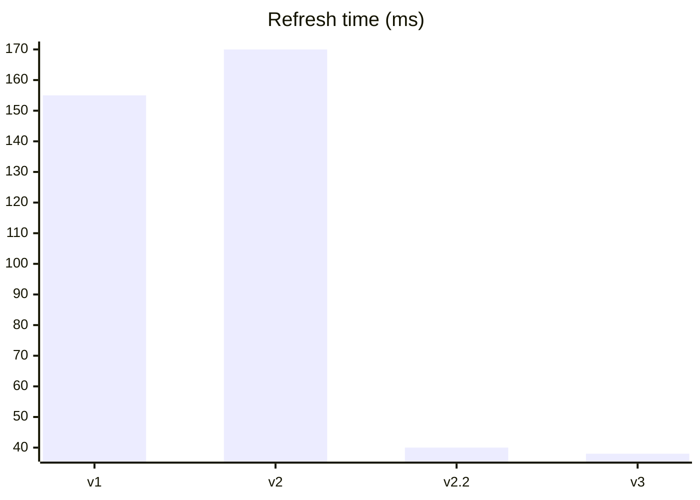

## The code

```js
export const bar = (pct, ramp = palette.ramp) => gradientBar(pct, 14, ramp)
const label = "context " + pct + "%"   // shown beside the bar
```



> [!NOTE]
> Run `npm test` in **v3-win** before applying.

- [x] ramp colours
- [x] two cells shorter
- [ ] a `sunset` palette
