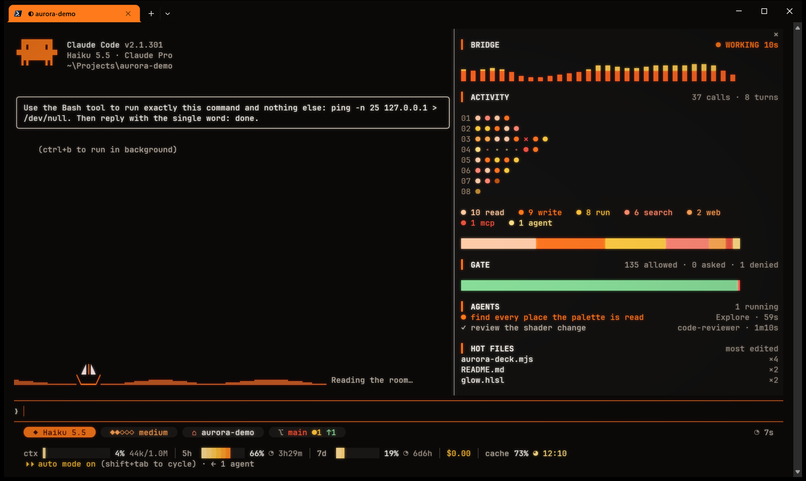
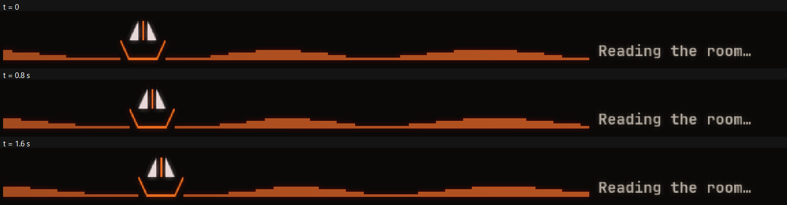
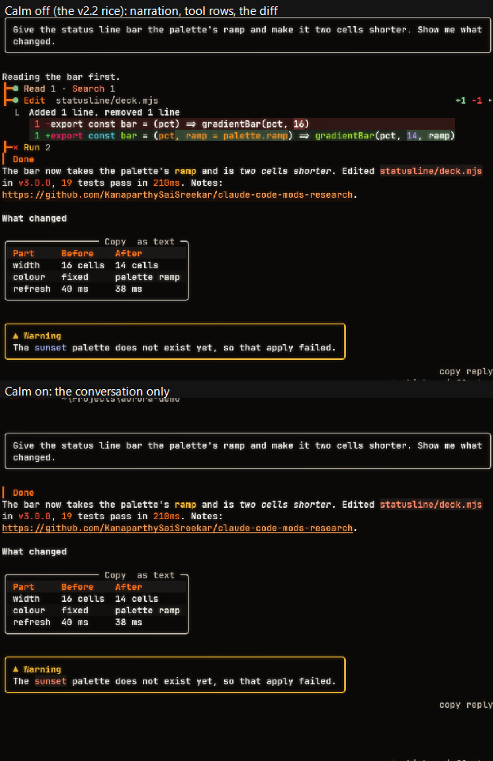
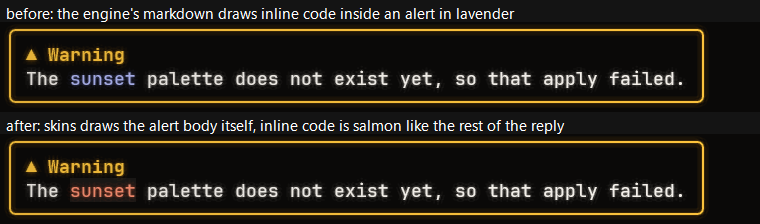

# v4-win: Firstmate Calm

v4 takes **Calm**, the visual mod inside [Firstmate](https://github.com/kunchenguid/firstmate) by Kun Chen (8,010 stars on 2026-10-17, one of the five most-starred repositories in the [awesome-claude-code-mods](https://github.com/karanb192/awesome-claude-code-mods) scan, and the most-starred one whose mod is a pure look-and-feel change). While Calm is on, the working spinner becomes a **sailboat crossing a swell**, and tool rows and short mid-turn narration are hidden, so the transcript reads as **just the conversation**. `/calm` toggles it.

Upstream Calm does nothing on a normal Claude Code today, writes its setting into an unrelated folder, and draws two of its glyphs from a fallback font on this machine. v4 is a small fork that fixes those, paints the boat in the rice palette, and runs on top of the v2.2 rice (skins for the reply text, the Bridge pane, the status line).



*A real Claude Code turn (one short Haiku prompt that runs a 25-second `ping`). The tool row is hidden. Your spinner verb stays beside the boat.*



## What Calm hides



- **Hidden:** tool rows and their results, and a short line of narration written just before a tool call ("Reading the bar first."). Anything longer than 240 characters or more than one line stays.
- **Kept:** your prompts, Claude's replies (drawn by skins, in the palette), alerts, tables, the turn footer.
- **Where activity went:** the Bridge pane on the right still shows every call as it happens, so Calm + Bridge is "talk on the left, work on the right".

## What I changed in Calm

The fork lives in the pinned marketplace as `firstmate-calm` (`claude-mods-local`: `0a81e92` unmodified upstream at `d20196a`, then `2101a3e` and `4507469`). The whole diff is [`patches/firstmate-calm-rice.patch`](patches/firstmate-calm-rice.patch). Calm's picture and its classifiers (the sprite, the swell, which text is a working note) are upstream's; I rewrote only the glue that talks to Claude Code (`hooks/register.ts`).

| Upstream | Why it does not work here | The fork |
|---|---|---|
| Does nothing unless `CLAUDE_CODE_ENABLE_FUNCTION_HOOKS` is exactly `1` | That variable was the opt-in before mods launched (2.1.287); a normal Claude Code does not set it, so Calm loads and stays inert | Active whenever the plugin is enabled |
| Keeps on/off in a `config/calm` file three folders above the plugin | From a marketplace copy that is `C:\Users\Kasasree\Projects\config\calm`, an unrelated folder | Kept in the mod's own store; the `start` option sets the first value |
| Reads Firstmate's state folder every 3 s and reads files named in "doorbell" prompts | Firstmate fleet features; there is no fleet here | Removed, so the mod has **no file system and no environment access** at all |
| Sails drawn with `◿` and `◣` | Neither is in JetBrainsMono Nerd Font Mono; Windows Terminal borrows them from another font at another width and they spill into the next cell (the bug v2.2 fixed in the status line) | The Powerline triangles `U+E0BA` and `U+E0B8`, which every Nerd Font has and which fill the cell edge to edge |
| Claude's spinner blue water, Claude orange boat, by theme family | Blue is out of the palette | A `palette` option: orange hull and mast, cream sails, a dim ember sea (the prompt frame's colour), muted word; `apply` writes it from the palette file |
| Replaces the whole working row | Your `spinnerVerbs` disappear | The verb stays to the right of the boat (`showVerb`) |

Tests: 26, all passing (`claude plugin test`). Upstream's transcript tests that still apply are kept, with `LOCAL PATCH` notes where the fork changed what they check; the boat tests were rewritten for the new glyphs, colours and word; `tests/rice.test.ts` covers activation without the variable, the stored toggle, the palette option and a glyph check against the font.

## Two things I found on the way

- **Mods load in the order of `enabledPlugins` in `settings.json`, and the first one loaded is the outermost.** With skins listed first (as it is in your file), skins draws the tool rows and the narration itself and never passes them on, so Calm could hide only the diff under the Edit row. Moving `firstmate-calm` in front made it work (measured with `claude --debug`: the "hooks module ... loaded" lines follow the key order). v4's `version.json` has `"first": ["firstmate-calm@kasasree-mods"]` and the kit's `apply` moves it to the front; `revert` puts the order back.
- **Upstream's own test suite fails 39 of 51 on Windows, unmodified.** Its in-memory file system is keyed by POSIX paths like `/fm/home/config/calm`, and Claude Code hands a mod's `$.fs` calls to the test hooks as `C:\fm\home\config\calm` (checked with a one-test probe plugin). It is a test portability bug, not a bug in Calm, and the fork no longer reads files anyway. Not reported upstream; that is your call.

## A fix to skins, found here



Inside a `> [!WARNING]` box, `sunset` was **lavender**: skins handed alert bodies to Claude Code's own markdown, whose inline code colour no skin or theme reaches. The skins patch (`8fedaa6`, [`patches/skins-alert-body.patch`](patches/skins-alert-body.patch)) draws the body with the skin's own blocks. It applies to the v2.2 rice too. A new test fails without it; the skins suite is 221/221.

## Use it

```powershell
cd v4-win
npm test                                   # 5 tests: palette, load order, apply/revert, preview-order
node tools/rice.mjs apply --dry-run        # shows "load first: firstmate-calm@kasasree-mods"
node tools/rice.mjs apply [ember|amber|crimson]
node tools/rice.mjs revert
```

Restart Claude Code after `apply`. `/calm` toggles it in a session and the choice is kept. Options (`/plugin configure firstmate-calm@kasasree-mods`): `start` (`on`/`off`), `showVerb`, `palette` (a JSON object of `#RRGGBB` for `boat`, `sail`, `water`, `label`).

v4 turns **skins on and prismantis off**: Calm hides rows, it does not draw replies, and skins draws them in the palette. (v3 and v4 do not combine: prismantis would have to sit behind Calm the same way, which works in principle but was not tested.)

## Is it safe

`claude plugin validate` on the fork lists only `$.store`, `$.clock.every`, `$.command.register`, `$.session.messages`, and the `$.ui` calls that draw (`resolve`, `blit`, `invalidate`, `toast`). No file system, environment, processes or network. It reads the transcript once at start to know which restored lines were narration. It hides drawings only; the stored transcript and what the model sees are unchanged.

## What I verified, and how

- **A real turn** (the only usage spent in v3 to v6: two short Haiku prompts): the boat draws and animates (three captures 0.8 s apart), the tool row is hidden, the verb shows, and the Bridge pane counted the live call (its row 08 and `135 allowed`). That last one is also the first live-turn check of the Bridge, which v2 had listed as unverified. The first attempt used `sleep 25`, which Claude Code's Bash tool now refuses as a standalone sleep; the second used `ping -n 25`.
- **The conversation-only look** on the synthetic demo session, with Calm off and on, and the alert fix before and after.
- **The order rule**: two `--debug` runs differing only in the key order of `enabledPlugins`.
- Every preview reordered `settings.json` only for its own run and put it back byte for byte (`preview-order off`, then compared with `cmp`). The two real preview sessions were deleted afterwards.

## What I did not verify

- **Amber and crimson boats** in the real UI. The palette builder and the plugin's palette parsing are tested; only Ember was photographed in a live turn.
- **Subagents and long turns:** a subagent's narration never draws in the main transcript, so Calm leaves it alone (an upstream test covers this), but I watched only one short turn.
- **The desktop app**: Calm leaves non-terminal surfaces to Claude Code.

## Layout

```
version.json                    what v4 switches, including "first"
tools/rice.mjs                  v4's CLI (the kit is v3-win/tools/kit.mjs)
patches/firstmate-calm-rice.patch   the fork, against the unmodified pin
patches/skins-alert-body.patch      the skins alert fix
tests/v4.test.mjs
docs/screenshots/
```

The preview tools are v3's: `v3-win/tools/demo-session.mjs`, `v3-win/tools/preview/scene.ps1` (it now also takes `RICE_PREVIEW_PROMPT` for a live turn and `RICE_PREVIEW_ARGS`, for example `--debug`), and v2's `shot.ps1`.
