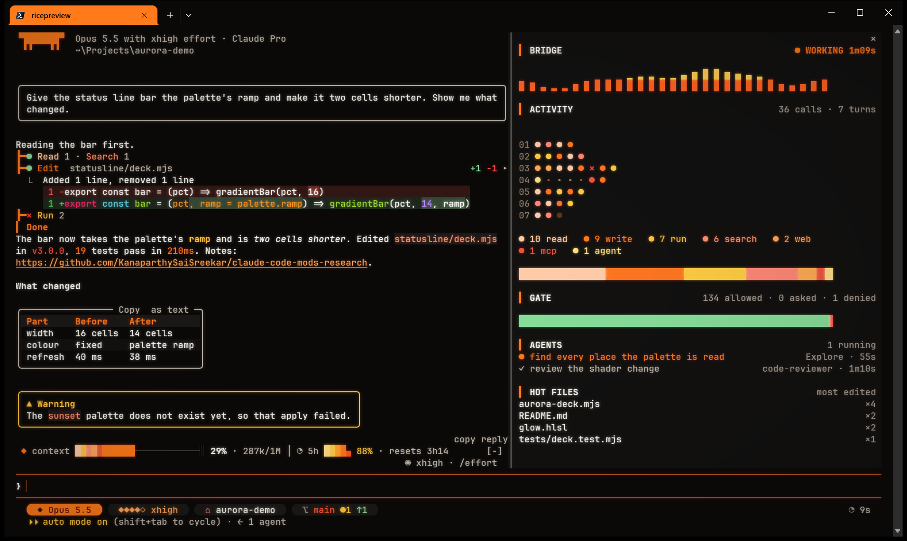
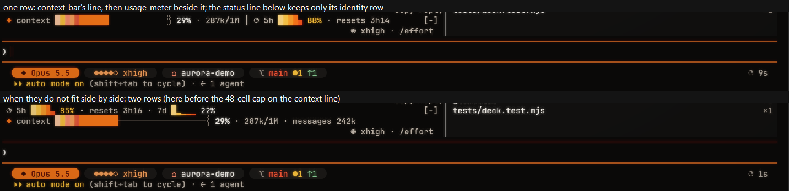

# v5-win: Ember meters

v5 takes two mods from [hamzafer/claude-code-mods](https://github.com/hamzafer/claude-code-mods) by Hamza Zafar (265 stars on 2026-10-17, 25 mods, one of the most-starred mod collections in the [awesome-claude-code-mods](https://github.com/karanb192/awesome-claude-code-mods) scan):

- **context-bar**: your context window as a stacked bar, one colour per category (system prompt, tools, MCP, skills, messages, free space, the auto-compact buffer).
- **usage-meter**: the 5-hour and 7-day plan windows as small bars with the reset countdown, the session cost, and a toast at 90%.

v5 draws both **on one row above the prompt**, in the palette, and moves those numbers out of the status line, which keeps only its identity row. **One source per number** still holds: context, 5h, 7d and cost appear once.



*Claude Code 2.1.301 resuming the synthetic demo session with v5 applied for that one process. The 5h and 7d numbers are real (Claude Code keeps the last reading).*



## What I changed

Pinned unmodified at `77f1ebc` (`claude-mods-local` commit `0464dcd`), then two commits (`5220f94`, `7c997a8`). Diffs: [`patches/context-bar-rice.patch`](patches/context-bar-rice.patch), [`patches/usage-meter-rice.patch`](patches/usage-meter-rice.patch).

| | Upstream | v5 |
|---|---|---|
| context-bar colours | fixed Tokyo Night blues and purples per category, a green/yellow/red pill | a `palette` option: the six warm tool shades per category, messages in the accent, free and buffer dim, the percentage plain until 70% |
| context-bar shape | a bordered box with a legend, 4 or more rows | `style: line`: one row, no border (`◆ context ▰▰▰── 29% · 287k/1M · messages 242k`); `maxWidth` caps it (v5: 48 cells) so the meter fits beside it. `box` stays the default |
| usage-meter colours | named green, yellow, red | a `palette` option with a ramp: each bar cell takes the ramp colour of its place (pale gold to flame, like the v2 status line's gauges); the percentage plain until 75%, then amber, then red |
| usage-meter glyph | `⏱` | `◔`. `⏱` is not in JetBrainsMono Nerd Font Mono, and upstream already noted it "can draw two cells wide" |
| one row | two separate bands | `join: on`: usage-meter finds context-bar's line beneath it and fits its own parts into the room left (the 7d window, then the cost, go first); if even the 5h window does not fit, it takes its own row |

**The status line** (`v2-win/statusline/aurora-deck.mjs`, now in the v2 folder too): with `AURORA_DECK_ROWS=1` it draws only the identity row (model, effort, folder, git, the clock) and moves the prompt-cache clock onto it. v5 sets that variable in `settings.json`'s `env` and copies the updated deck over the applied one in `~/.rice/current/statusline/` (backed up; without the variable it draws exactly what v2.2 drew). A new test covers one-row mode; the status line's suite is 20 tests (v2's whole suite, 51).

## Found on the way

- **Claude Code refuses a `Text` element that carries a `key` prop**, and when a hook's drawing is refused the engine draws its own instead: the joined row would simply have vanished. A test caught it before any screenshot. (A `Box` with a `key` is fine; that is how bands are named.)
- **Both upstream suites fail on Windows unmodified** (2 tests in context-bar, 1 in usage-meter): the band-order file is mocked at `/home/me/...` and Claude Code hands it to the test hooks as `C:\home\me\...`, the same issue v4 found in Calm. The fixtures now normalise the path (marked `LOCAL PATCH`). Tests: context-bar 26/26, usage-meter 20/20.
- **Load order matters again:** usage-meter has to load before context-bar to see its line in what the mods beneath it drew, so `version.json` lists it in `first` (v4's finding).

## Use it

```powershell
cd v5-win
npm test                                   # 5 tests: palettes, order, env, deck swap, apply/revert
node tools/rice.mjs apply --dry-run        # lists the env, the load order and the deck update
node tools/rice.mjs apply [ember|amber|crimson]
node tools/rice.mjs revert                 # restores settings.json and the old deck file
```

Restart Claude Code after `apply`. `/context-bar` hides or shows the context line. The usage bars appear once Claude Code has a rate-limit reading (after any reply; it keeps the last one between sessions).

v5 changes nothing about the transcript, so it combines with v2.2 (skins), v3 (prismantis) or v4 (Calm). Apply v4 first and v5 second and both `first` lists hold: usage-meter, then Calm, then the rest.

## Is it safe

Both mods read Claude Code's own usage figures (`$.session.usage`, the `session.measure` event), keep a small state, and read one optional file, the band-order file (`~/.claude/claude-code-mods/bands.json`, which does not exist here). No network, no processes, no writes. usage-meter shows a toast at 90% of a window. `claude plugin validate` passes for both.

## What I verified, and how

- The real UI on the synthetic session, twice: before the width cap (two rows, both windows) and after (one row). The 5h and 7d readings were real.
- The status line in one-row mode in that same UI: one identity row, no gauges.
- Every preview reordered `settings.json` only for its own run and put it back byte for byte.

## What I did not verify

- **The 90% toast** in the real UI (upstream tests cover it; they pass).
- **Amber and crimson** in the real UI (the builders are tested for warm, distinct colours).
- **Very wide terminals**: the bands were photographed at about 95 columns beside the Bridge. Wider, the 7d window and the cost join the row.

## Layout

```
version.json        plugins, load order (first), options, env, and the deck file to update
tools/rice.mjs      v5's CLI (the kit is v3-win/tools/kit.mjs: env and files support were added for v5)
patches/            context-bar-rice.patch, usage-meter-rice.patch
tests/v5.test.mjs
docs/screenshots/
```
