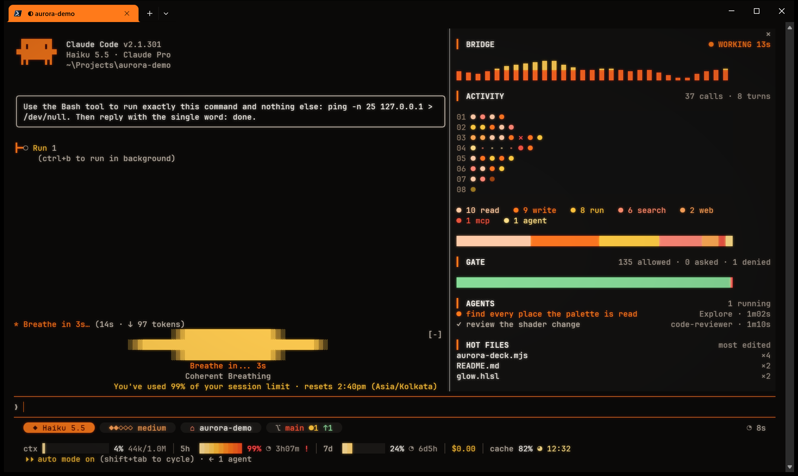
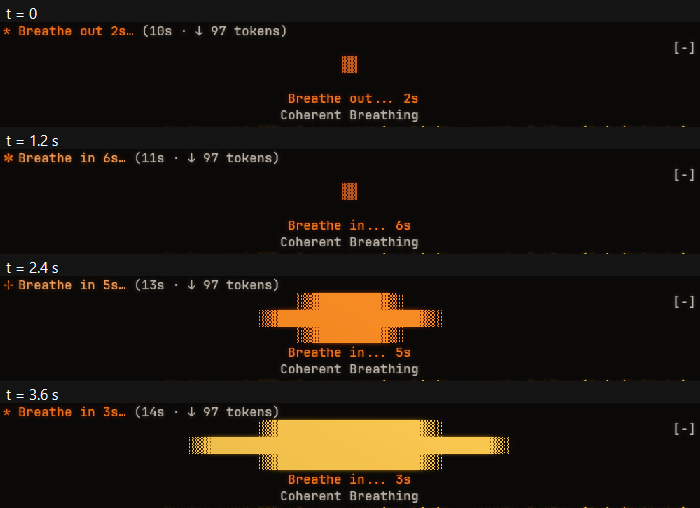

# v6-win: Breathing ember

v6 takes [Mindful-Claude](https://github.com/halluton/Mindful-Claude) by halluton (105 stars on 2026-10-17, MIT, and one of the few mods in the scan that only draws: no files, environment, processes or network). While Claude works, a **guided breathing band** sits above the prompt (coherent breathing, box, 4-7-8, the physiological sigh; four animation styles), and the spinner reads the breath (`Breathe in 3s…`). It disappears when Claude answers.

v6 makes it an **ember that breathes with you**: the picture's colour follows the breath along a warm ramp, dim ember with empty lungs to pale gold at the top of the inhale. The band is 5 rows instead of 9.





*A real Claude Code turn (one short Haiku prompt running a 25-second `ping`, the session deleted afterwards).*

## What I changed

The pinned marketplace copy is `mindful-breath` (`claude-mods-local`: `b3b1777` unmodified at `411c9c4`, then `0ba52b3`). The diff is [`patches/mindful-breath-rice.patch`](patches/mindful-breath-rice.patch).

- **The glow** (`hooks/breath/glow.ts`, new): a `palette` option with a `glow` ramp, an `accent` for the phase line and a `label` for the exercise name. Upstream draws all of it in one fixed orange. v6's ramp per palette: the dim accent, the accent, amber, the palest ramp stop.
- **Height:** a `rows` option, 3 to 9 (upstream always 9). v6 asks for 5: three rows of picture, the phase line, the exercise name.
- **Font:** the `dots` style's centre was `✦`, which JetBrainsMono Nerd Font Mono does not have; it is `◆` now. A test walks every style through a whole breath and checks every glyph against the font.
- **Name:** `mindful-claude` became `mindful-breath`. The validator warns that a name with "claude" in it reads as one of Anthropic's own; upstream's own `marketplace.json` was dropped too.
- **Tests that run:** upstream's tests import `bun:test`, which `claude plugin test` cannot load, so none of them ran. They now import `claude-code/testing` (and a loop replaces Bun's `test.each`): 31 upstream tests pass, plus 7 new ones (38/38).

## Use it

```powershell
cd v6-win
npm test                                   # 3 tests: the glow ramp, load order and rows, apply/revert
node tools/rice.mjs apply [ember|amber|crimson]
node tools/rice.mjs revert
```

Restart Claude Code after `apply`. `/breathe` picks the exercise (`hrv`, `sigh`, `box`, `478`), the style (`pulse`, `ripples`, `dots`, `wave`, `random`), a delay before it appears, and whether the spinner reads the breath. v6 combines with any of v2.2 to v5. It loads first so its spinner word reaches the spinner before skins draws it.

## Verified, and not

- **Verified:** a live turn (the frames above): the band appears while Claude works, glows along the ramp, and the spinner reads the phase; 38 plugin tests; `claude plugin validate` clean.
- **Not verified:** amber and crimson in the real UI (the builder is tested for four warm stops that brighten), the other three animation styles live (they are covered by upstream's shape tests and the glyph test), and the desktop app (the band is terminal-only upstream).
