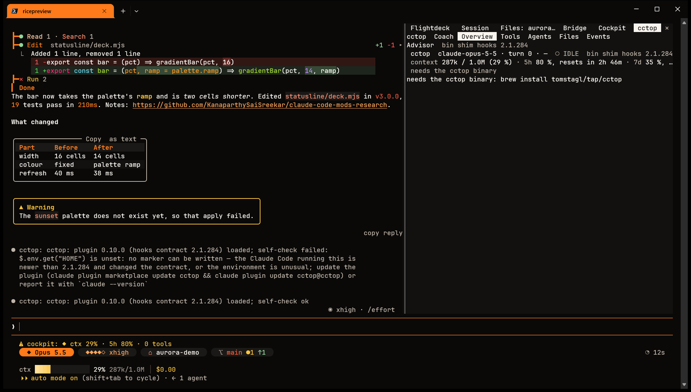

# v7-win: Six tabs

v7 puts six right-hand panes side by side as tabs, on the v2 Ember rice (palette, theme, skins, status line). Claude Code
draws every open pane as a tab of one sidebar ("With several panes open, each gets a tab that shows its title",
[mods interface docs](https://code.claude.com/docs/en/plugins/mods/interface)), so v7 just switches on six pane mods and makes each
one open its pane on start.



*The real Claude Code resuming a synthetic demo session with v7 live (no model turn). cctop is in front because it opens last.*

| Tab | Mod | What it shows | Where from |
|---|---|---|---|
| **Flightdeck** | [scasella/claude-flightdeck](https://github.com/scasella/claude-flightdeck) | main model vitals, on-call architect, permission gate, subagent cards and swimlanes, turn receipt, session log | v1 (all seven panels, as v1 had them) |
| **Session** | [markneonin/paneline](https://github.com/markneonin/paneline) | its own tabs: Activity, Files, Agents, Context, MCP, Skills, Spend | new |
| **Files: ...** | [data-goblin/claude-code-filetree](https://github.com/data-goblin/claude-code-filetree) | the project tree with git status and `+N -N` per file; files shimmer as Claude reads and edits them | v1 (now opens on start) |
| **Bridge** | first-party `aurora-bridge` | the heartbeat wave, one dot per tool call, the gate, subagents, hottest files, last turn's receipt | v2 |
| **Cockpit** | [drkokorev/cockpit-for-claude](https://github.com/drkokorev/cockpit-for-claude) | context, 5h/7d limits, cost, turn, agents, tools, files, tests, guard, alerts, history, all-time | new |
| **cctop** | [tomstagl/cctop](https://github.com/tomstagl/cctop) | btop-style: Coach, Overview, Tools, Agents, Files, Events, Advisor | new |

Switch tabs by clicking a title. `Ctrl+X` then `Tab` gives the pane the keyboard, `Ctrl+X` with the arrows resizes it, `Ctrl+X` then `X`
closes the tab in front.

## What I changed

The three new mods are pinned unmodified in `claude-mods-local` (`cd510b1`), then patched (`0ceeccc`, `f167d8b`). Diffs in [`patches/`](patches/).

| | Upstream | v7 |
|---|---|---|
| paneline | restyles every message, tool row and the band above the prompt, and adds a render hint to the prompt | a `chat` option (default on). v7 turns it off: only the pane, so the Ember skin keeps the chat |
| cctop | the pane opens only on `/cctop`, or when it was open at the last reload | an `openOnStart` option (default off). v7 turns it on |
| cctop | reads `HOME`, which native Windows does not set: the self-check printed a failure into the transcript on every start | falls back to `USERPROFILE` |

Options only, nothing patched: flightdeck `openOnStart` with all seven panels and its status line off (the Ember deck has the
numbers), filetree `start: on`, Bridge as in v2. cockpit has no options and opens itself.

## Use it

```
node v7-win/tools/rice.mjs apply ember     # switch the six on (settings.json backed up first)
node v7-win/tools/rice.mjs revert          # put settings.json back as it was
node v7-win/tools/rice.mjs status
```

Restart Claude Code after either. The panes dock beside the chat in the fullscreen layout from 110 columns (Bridge from 144);
narrower, they open above the prompt.

## Worth knowing

- **cctop without its binary.** The pane's context, cost and limits come from Claude Code itself. Tool timings, files, agents and
  the Advisor need the `cctop` program (Homebrew or cargo only, not installed here), so those views say "needs the cctop binary".
  It also logs one line into the transcript at every start (`cctop: plugin 0.10.0 ... self-check ok`).
- **cockpit's guard is on by default.** Before a Bash command it calls risky it asks Run it / Block it. `/cockpit-guard off` turns it
  off. It also puts a `◆ ctx · 5h · tools` line under the prompt; the "Status line" button in its panel turns that off.
- **cctop and cockpit ship skills/commands.** cctop adds two skills (`cctop`, `cctop-insights`) to the skill list.
- **Tab order** follows the order the mods open their panes at start, which v7 does not control.

## Is it safe

None of the six makes network requests or model calls (`claude plugin validate` lists every `$.` call; the table with each mod's
reach is in `claude-mods-local/README.md`). Processes started: read-only `git` (cockpit, paneline, filetree), `grep` (paneline; not on
Windows PATH, so it fails quietly), `du`/`find` (filetree), and `cctop` (absent, detected as missing).

## Verified, and not

- `node --test v7-win/tests/*.test.mjs`: 5/5 (all six on, each told to open, every option exists in that mod's manifest, apply and
  revert byte-exact).
- paneline: `claude plugin test` with the new `chat-option.test.tsx` (3/3). The suite fails the same 28 tests on Windows as
  unmodified upstream (POSIX path fixtures, one timeout).
- cctop: upstream's harness (outside `plugin/`) with two new tests, 127/129; the same 2 failures as upstream (CRLF snapshots).
- Live: the screenshot above, at 210 columns. Not seen yet: each tab during a real turn, and how the six together feel over a session.

## Layout

`version.json` (what v7 switches), `tools/rice.mjs` (CLI over `v3-win/tools/kit.mjs`), `tests/`, `patches/`, `docs/screenshots/`.
